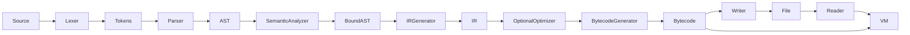

# Architecture

| Component | Responsibility | Implementation |
| --- | --- | --- |
| SourceManager | Own immutable filename/text; map byte offsets to 1-based line/column | source.hpp / source.cpp |
| DiagnosticEngine | Collect source errors; format filename:line:column | source.hpp / source.cpp |
| Lexer | Scan ASCII tokens, decimal literals, comments, operators | lexer.hpp / lexer.cpp |
| Parser | Recursive descent with one function per precedence level; panic recovery | parser.hpp / parser.cpp |
| AST | Expression and statement nodes with exclusive owning edges | ast.hpp / ast.cpp |
| SemanticAnalyzer | Scope stack, duplicate checks, initializer visibility, stable IDs | semantic.hpp / semantic.cpp |
| IRGenerator | Lower bound statements/expressions to instructions and labels | ir.hpp / ir.cpp |
| IROptimizer | Fold valid literal operations; propagate literal-derived temporaries | optimizer.hpp / optimizer.cpp |
| BytecodeGenerator | Assign numeric slots; expand IR; fix up numeric branch targets | bytecode.hpp / bytecode.cpp |
| BytecodeReader/Writer | Strict versioned text serialization and structural validation | bytecode.hpp / bytecode.cpp |
| disassemble | Deterministic indexed instruction dump for library users | bytecode.hpp / bytecode.cpp |
| checkedArithmetic | Portable checked int64 operations, shared by optimizer and VM | arithmetic.hpp / arithmetic.cpp |
| VirtualMachine | Stack/slot execution, trace, runtime diagnostics, step limit | vm.hpp / vm.cpp |
| Compilation | Own frontend state and issue IR only after successful checks | compiler.hpp / compiler.cpp |
| CLI drivers | Parse options, read/write files, orchestrate stages, map exit codes | driver.hpp / driver.cpp |

## Ownership and stage boundaries

`Compilation` owns its `SourceManager`, tokens, `Program`, and diagnostics.
It cannot be copied or moved because its bound view refers to its owned AST.
AST edges use `std::unique_ptr`; finite kinds use `enum class`. Source spans
are half-open byte offsets `[begin,end)`, and the manager handles line lookup.
With ASCII language tokens, columns are byte columns; tabs count as one byte.

Semantic analysis annotates the same AST with `SymbolId` values. On success
it returns a `BoundProgram` view and symbol table. The view is non-owning;
the original `Program` must outlive it. Failed syntax or semantics produces
no bound view, and `Compilation::lower` returns no IR. Dumps of earlier stages
are still available when those stages succeed.

Names identify declarations for humans; numeric symbol IDs identify storage.
A scope stack of hash maps searches innermost to outermost. IDs are allocated
in source traversal order, never by hash-map iteration, keeping dumps stable.
The declaration initializer is analyzed before its name enters the current
scope. A loop body is bound once but its initializer instructions run each
iteration.

The parser catches statement failures and synchronizes at semicolons,
closing braces, or the start of another item. It consumes a token when a
failed item made no progress, except for EOF and a closing brace belonging
to the enclosing block. Top-level stray braces are consumed explicitly.
An AST recovered with errors is never passed to the semantic/backend stages.

IR owns value instructions, operands, source spans, and debug symbols. It
holds no AST pointers. Bytecode owns numeric instructions and source filename/
line/column metadata, so execution and runtime locations do not require the
original `.mc` file. The bytecode file is the serialization of that same
in-memory program. `--run` and `minic-vm` both invoke `VirtualMachine::execute`.

## Errors

Frontend errors accumulate in `DiagnosticEngine`. Structural bytecode errors
throw `BytecodeError`; execution errors throw `RuntimeError` with a source
location. CLI code converts them into documented status codes and stderr.
The VM validates even in-memory bytecode before dispatching. Arithmetic is
checked before performing any potentially undefined signed operation.
